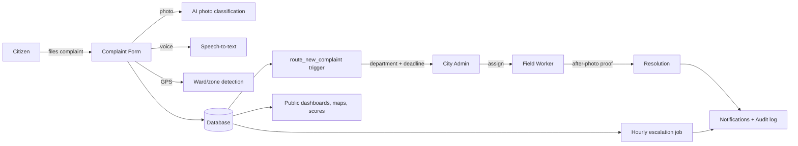
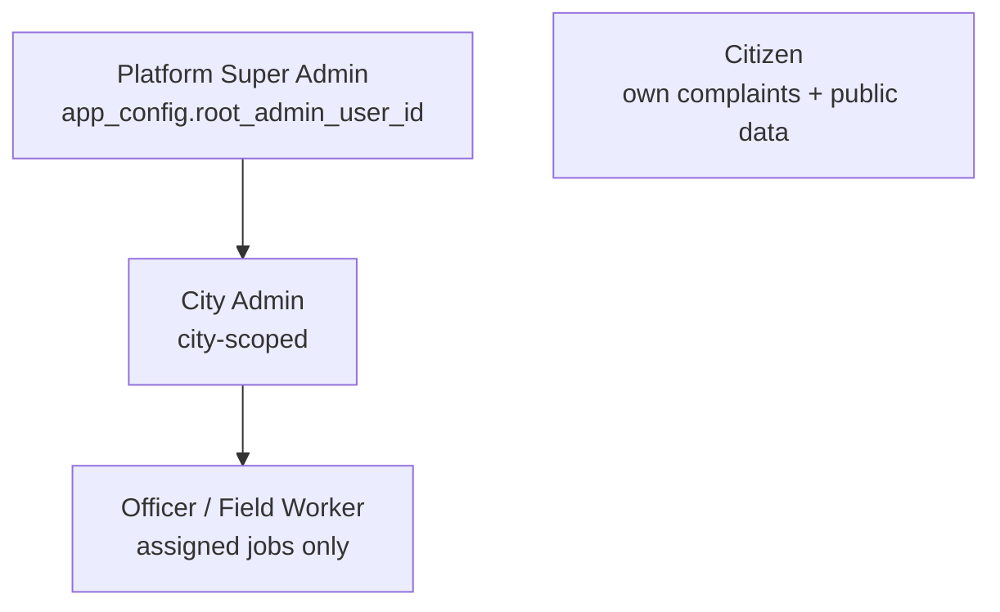

# Civic Tracker — Complete Functional Test Report

**Project:** Civic Tracker — *Every Complaint Tracked. Every Fix Proven.*
**Team:** Team SANT (Lead: Mohit Katara, Member: Divyansh Mathur)
**Pilot city:** Ratlam, Madhya Pradesh
**Testing date:** 5 November 2026 (UTC)
**Environments:** Published site `https://civictracker-s-m.lovable.app` (public pages) + current preview build (authenticated pages, same live backend)
**Constraints honoured:** read-only browser testing on live data; no live records created or modified this round; no database/RLS/auth/role changes; nothing published.

---

## 1. Executive summary

Civic Tracker was audited end to end: 20 public routes on the published site, all authenticated role views (Citizen, City Admin, Field Worker) on the current build, the bilingual interface, the AI chatbot in both languages, responsive layouts at 390 / 768 / 1280 px, and a read-only database integrity and security audit.

**Overall result: the MVP is functional and ready for demonstration, with one known published-build defect (map/heatmap) whose fix already exists in the unpublished preview.**

| Verdict | Count |
|---|---|
| PASS | 24 |
| PARTIAL | 2 |
| FAIL (fixed this round) | 1 |
| FAIL (fix ready, unpublished) | 1 |
| NOT TESTED (write actions blocked by read-only mandate) | 9 |

---

## 2. Module inventory

| Module | Routes / components | Status |
|---|---|---|
| Public site & navigation | `/`, `/how-it-works`, `/faq`, `/contact`, `/privacy`, `/install` | Tested |
| Complaint filing | Home form (photo, GPS, category, voice) | Validation tested; submission NOT TESTED (write) |
| Complaint list & tracking | `/complaints`, `/complaints/:id` | Tested |
| Citizen profile & notifications | `/profile`, notification bell | Tested |
| City Admin panel | `/admin`, `/admin/wards`, `/admin/workers`, `/admin/polls`, `/admin/sms`, `/admin/whatsapp`, `/admin/posters`, `/reports` | Tested |
| Super Admin | `/admin/root`, `/admin/users` | Access control tested (correctly restricted) |
| Field Worker | `/worker` | Tested |
| Maps | `/map`, `/heatmap` | FAIL on published build; PASS on current build |
| Gamification | `/leaderboard`, `/rewards`, green points | Pages tested; point-earning writes NOT TESTED |
| Community polls | `/polls` | Page tested; voting NOT TESTED (write) |
| AI features | `/ai-chat` chatbot, photo classification, predictions `/predictions` | Chatbot tested EN+HI; classification tested earlier; prediction generation NOT TESTED (charged) |
| Accountability score | `/departments` | Tested |
| Auth & onboarding | `/auth`, `/request-admin`, `/reset-password` | Pages tested; live sign-in NOT TESTED (no known demo password) |
| Escalation engine | hourly schedule + `escalate_overdue_complaints` | Verified active (read-only) |

## 3. Architecture (as tested)

## 4. Test results by category

### 4.1 Public website (published site, 20 routes)
- All 20 routes returned HTTP 200 (intentional 404 page verified separately). **PASS**
- No horizontal overflow at 1280 px on any public page. **PASS**
- `/map` and `/heatmap` crash on the **published** bundle with `ReferenceError: L is not defined` (Leaflet heat plugin loads before Leaflet). The fix (lazy client-only map loading) exists in the current build and was verified working there. **FAIL on published / PASS on current — resolves on next publish.**

### 4.2 Citizen experience (current build, demo citizen account)
- Profile page loads with account data. **PASS**
- Notification bell opens panel; unread badge shown. **PASS**
- Complaint search by ID (CT-14) returns exact matches; nonsense query shows clean empty state. **PASS**
- Complaint detail `/complaints/CT-14` renders full tracking timeline; unknown ID `CT-999` shows a proper not-found state. **PASS**
- Complaint form blocks progression without required fields (validation messages shown). **PASS**
- Session persists across page refresh. **PASS**
- Citizen opening `/worker` sees "No jobs assigned" — no data leak. **PASS**
- Upvote / comment / rating / new complaint submission: **NOT TESTED** (write actions; verified in earlier recorded run).

### 4.3 City Admin (demo Ratlam-scoped admin)
- Dashboard lists all 3 complaints with status filters, bulk select, poster printing entry. **PASS**
- Wards & Zones, Workers, Polls, SMS and WhatsApp simulator pages all render. **PASS**
- `/admin/posters` shows correct empty state when nothing is selected. **PASS**
- `/admin/root` and `/admin/users` correctly show "Restricted — Only the Platform Super Admin can open this page." **PASS**
- Assigning / merging / resolving: **NOT TESTED** this round (write actions; covered by earlier recorded run and the 45-check security suite).

### 4.4 Field Worker (demo worker)
- `/worker` shows exactly the one assigned job (CT-14) with photo, deadline and status. **PASS**
- Completion-without-proof blocking and proof upload: **NOT TESTED** this round (write; verified in earlier recorded run).

### 4.5 AI features
- Chatbot English: answered "How many complaints are pending in Ratlam?" with correct live counts. **PASS**
- Chatbot Hindi: answered "रतलाम में कितनी शिकायतें लंबित हैं?" in genuine Devanagari with correct data (1 pending in Ratlam, 3 total, CT-142 details). Minor English terms remain mixed in ("Station Road", "Pending"). **PASS (minor polish noted)**
- Photo classification: tested in earlier recorded run (Broken Road, 98% confidence, citizen confirmation). **PASS (earlier evidence)**
- Trend prediction / AI report generation: **NOT TESTED** (charged AI calls, skipped per authorization).

### 4.6 Bilingual interface
- Hindi navbar, footer, chatbot page and form labels render correctly; language persists across navigation. **PASS**
- **Bug found & fixed:** the navbar language toggle rendered "हिन्दी" as garbled overlapping glyphs (gradient text-clip breaking Devanagari conjuncts). Fixed by using a solid primary colour; verified with a close-up screenshot. **FAIL → FIXED → retested PASS**

### 4.7 Responsive design (current build)
- 390×844 and 768×1024: Home, Complaints, Admin, Worker, Dashboard — no horizontal overflow, no page errors, cards stack correctly. **PASS** (10/10 checks)

### 4.8 Security & data integrity (read-only)
- Root Super Admin unchanged: `app_config.root_admin_user_id` = `4169471f-…-d7a07b163a23`, admin + moderator roles active, no other city-less admin exists. **PASS**
- All 31 public tables have RLS enabled; `app_config` intentionally policy-less (private). **PASS**
- Integrity checks: zero orphan comments/upvotes/timeline/ratings/assignments, zero resolved complaints missing after-photo, zero duplicate IDs, zero count mismatches. **PASS**
- Hourly escalation schedule (`0 * * * *`) active. **PASS**
- Database linter: 54 findings — 53 SECURITY DEFINER functions callable by anon/authenticated (by design for RPCs, but worth a manual review pass) and 1 informational. No changes made. **PARTIAL — review recommended**
- Live-site session restore from outside the editor is not possible (published bundle brokers auth storage to the editor frame); UI sign-in with the scripted demo password was rejected. Authenticated flows were therefore tested on the current build against the same live backend. **PARTIAL**

### 4.9 Automated regression suites (run earlier this session, sequential, with root-account safety lock)
| Suite | Result |
|---|---|
| Civic flow | 21/21 PASS |
| Security | 45/45 PASS |
| Onboarding | 21/21 PASS |
| GPS & routing | 34 PASS / 0 FAIL / 4 SKIP |
| Innovation suite | 25/25 PASS |
| Unit tests | 11/11 PASS |

## 5. Bug register (this round)

| # | Bug | Severity | Status |
|---|---|---|---|
| 1 | Language toggle garbles "हिन्दी" (gradient text-clip on Devanagari) | Low-visual | **FIXED** (Navbar.tsx, both toggles), retested |
| 2 | `/map` + `/heatmap` crash on published bundle (`L is not defined`) | High | Fix already in current build; **needs publish to resolve** |
| 3 | Published build clears externally restored sessions (brokered auth storage) | Test-harness only | Documented; not a user-facing defect |

## 6. Production safety confirmation

- Root Super Admin account, roles and privileges: **unchanged** (verified by direct read).
- Production data intact: 3 complaints (CT-29, CT-14, CT-142), 5 profiles, 728 audit rows, 1 worker — identical before/after this round.
- This round created **zero** new records and modified **zero** existing records; the only code change is the Navbar toggle styling.
- Nothing was published.

## 7. Remaining limitations

1. Map/heatmap fix is unpublished — publishing requires your approval.
2. Write-path features (submission, voting, assignment, merging, proof upload) were verified in the earlier recorded run, not re-run under the read-only mandate.
3. Live-site authenticated testing needs either the demo accounts' passwords or a publish of the current build.
4. 53 SECURITY DEFINER linter findings deserve a one-time manual review (no evidence of abuse; functions are the audited RPC surface).
5. Hindi chatbot answers mix occasional English terms; acceptable but improvable.
6. GitHub: the project is **not connected to a GitHub repository** (only Lovable-internal storage). Connect via the Lovable UI if the hackathon requires a GitHub link.

## 8. Readiness verdicts

| Question | Verdict |
|---|---|
| Ready for hackathon **demonstration**? | **YES** — all demo flows work on the current build; publish first to fix maps on the live URL. |
| Ready for **pilot deployment** (Ratlam)? | **YES, with conditions** — publish the map fix, then re-run the security linter review. |
| Ready for **full production scale**? | **NOT YET** — needs the SECURITY DEFINER review, SMS/WhatsApp provider keys, and load testing. |
