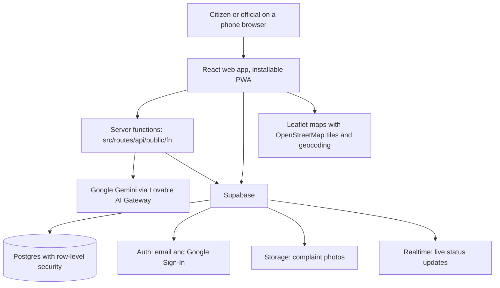

# Civic Tracker

**Every Complaint Tracked. Every Fix Proven.**

Team SANT (Mohit Katara, team lead; Divyansh Mathur) · Unstop CodeQuest 2026 · Pilot city: Ratlam, Madhya Pradesh

Civic Tracker is a mobile-first, multilingual web platform where citizens report civic problems (garbage, broken roads, waterlogging, streetlights and more) by text, photo or voice, and city officials resolve them in public view. Google Gemini reads every request, suggests the category and priority, answers questions in the citizen's language, and turns the data into hotspots, trend forecasts and reports for planners.

- **Live prototype:** https://civictracker-s-m.lovable.app
- **Test report:** [docs/END_TO_END_TEST_REPORT.md](docs/END_TO_END_TEST_REPORT.md)
- **Latest authorized security remediation:** [results, shared-Live impact, integrity and GitHub limitations](docs/FINAL_AUTHORIZED_SECURITY_REMEDIATION.md); [emergency rollback SQL](docs/D1_D4_PUBLIC_ACCESS_ROLLBACK.sql). Includes 26 migrations, daily reward caps, same-city worker opt-in and restricted public data. Compatible code is not yet published.
- **Hackathon track:** Problem Statement 01, AI for Digital Public Infrastructure & Governance (Theme: Innovation)

---

## Built with Google AI

Google AI is the core of Civic Tracker, not an add-on. **Google Gemini powers 9 server functions** across the citizen, official and planner experience, and **Google Sign-In** gives citizens one-tap access.

| Google technology | Where it is used in Civic Tracker | What it does |
|---|---|---|
| **Gemini 3 Flash (preview)** | `civic-chat`, AI Chat page | Civic AI assistant. Answers questions from live complaint data and replies in the citizen's language (English, Hindi, Marathi, Tamil, Bengali, Telugu, Gujarati, Punjabi) |
| **Gemini 2.5 Flash** | `analyze-image`, complaint form | Looks at the uploaded photo and suggests the complaint category |
| **Gemini 2.5 Flash-Lite** | `generate-summary`, after submission | Writes a short summary and raises the priority when the issue is serious |
| **Gemini 2.5 Flash-Lite** | `analyze-sentiment` | Scores the tone and urgency of the complaint text |
| **Gemini 2.5 Flash** | `voice-stt` | Turns spoken complaints into text, including Hindi and Hinglish, exactly as spoken |
| **Gemini 2.5 Flash** | `voice-transcribe` | Translates a spoken complaint into English and suggests its title, category and priority |
| **Gemini 2.5 Flash** | `predict-trends`, Predictions page | Forecasts complaint trends for the next two weeks by area and category, in English or Hindi |
| **Gemini 2.5 Flash-Lite** | `generate-admin-report`, Reports page | Writes the AI insight summary in weekly and monthly admin reports |
| **Gemini 2.5 Flash** | `whatsapp-webhook` (test mode) | Turns a WhatsApp message into a structured complaint |
| **Google Sign-In** | Login page, "Continue with Google" | One-tap sign-in for citizens, no new password needed |

**How Gemini is used:** every Gemini call runs on the server, never in the browser, through the Lovable AI Gateway. Gemini uses function calling to return structured fields (category, priority, summary, sentiment, trend), so its output is saved directly in the database and drives the map, dashboard and reports.

Maps in this build use Leaflet with OpenStreetMap data. Google Maps, Firebase and Google Cloud Vision are not used yet.

---

## Table of contents

1. [The problem](#the-problem)
2. [What Civic Tracker does](#what-civic-tracker-does)
3. [Feature status](#feature-status)
4. [Architecture](#architecture)
5. [Tech stack](#tech-stack)
6. [Project structure](#project-structure)
7. [Getting started](#getting-started)
8. [Configuration](#configuration)
9. [Database](#database)
10. [Server functions](#server-functions)
11. [Scaling across India and BRICS](#scaling-across-india-and-brics)
12. [Roadmap](#roadmap)
13. [Security and privacy](#security-and-privacy)
14. [Open-source credits](#open-source-credits)
15. [License](#license)

---

## The problem

Citizen feedback in India is spread across many systems. Central grievances go to CPGRAMS, states run their own portals, and local issues such as garbage, roads and drains go to separate city channels. Citizens do not know if anyone is working on their complaint, and governments cannot see where the real demand is. As a result, infrastructure gaps stay hidden and public spending is hard to match with real needs.

## What Civic Tracker does

**For citizens**
- Report a problem in under a minute with a photo, automatic GPS location (or a map picker), category and priority.
- Speak the complaint instead of typing.
- Get a unique public ID (for example `CT-142`) and track the status live, with a deadline countdown and a timeline of every update.
- Ask the Civic AI assistant questions in eight Indian languages.
- Report anonymously when needed. Only the name is hidden.
- Comment, upvote, verify ("I have seen this too"), share and rate the resolution.
- Earn green points and badges from Bronze to Diamond.

**For city officials**
- City-scoped admin panel: each admin manages the complaints of their own city. The database enforces this with row-level security.
- Change status (Pending, In Progress, Resolved, Escalated), add admin notes and upload a resolution photo as proof. Citizens see a before and after comparison.
- Filter by status and city, print complaint posters, export CSV and PDF.
- Create community polls, manage departments, and generate weekly or monthly AI reports.
- New officials request admin access. The main admin approves the request, grants the role for one city, and can remove it at any time.

**For planners**
- Complaint map with clusters, markers, heatmap and area statistics.
- Hotspot page with time range, city and category filters and the worst areas.
- Public analytics dashboard: totals, resolution rate, average resolution time, monthly trend, and breakdowns by category, area and priority.
- Gemini trend forecast for the next two weeks by area and category.

## Feature status

Status as verified on 5 November 2026 (see the test report for evidence).

| Status | Features |
|---|---|
| **Tested end to end** | Photo complaint with GPS, automatic city/ward/zone detection, department routing with deadline, AI photo category suggestion (citizen must accept), duplicate warning, City Admin merge and undo, worker assignment, field-worker jobs page, after-repair photo required to resolve, public tracking with before/after proof, rating, notification bell, Hindi interface, city isolation and role security |
| **Tested by automated scripts only** | Automatic escalation (L1 officer, L2 City Admin, L3 Super Admin), Public Accountability Score formula, City Admin applications, new-city onboarding |
| **Built, not re-tested in this round** | Hindi/English voice input with confirmation, Civic AI chat, trend predictions, AI admin reports, polls, rewards store, leaderboard, heatmap, offline drafts, CSV/PDF export, posters with QR codes |
| **Needs external setup** | Real SMS (Twilio keys), real WhatsApp intake (business number; built-in simulator works without it), email reports |
| **Demonstration data** | Ratlam ward boundaries are demo data, not official boundaries |

## Architecture



Every change is saved in one database and pushed live to all open screens, so the public feed, the map, the dashboard and the AI forecasts all use the same data.

## Tech stack

| Layer | Technology |
|---|---|
| Frontend | React 19, TypeScript 5, TanStack Start and TanStack Router, Vite 8 |
| UI | Tailwind CSS 4, shadcn/ui (Radix UI), lucide-react, framer-motion, sonner |
| Data fetching | TanStack Query 5 |
| Maps | Leaflet 1.9, react-leaflet 5, leaflet.markercluster, leaflet.heat, OpenStreetMap |
| Charts | Recharts 2 |
| Backend | Supabase (Postgres, Auth, Storage, Realtime), hosted on Lovable Cloud |
| Server logic | TanStack Start server routes in `src/routes/api/public/fn` |
| AI | Google Gemini through the Lovable AI Gateway |

## Project structure

```
.
├── public/                        Static files, PWA manifest and icons
├── src/
│   ├── components/                Reusable UI (map picker, voice input, notification bell, before/after slider, ...)
│   │   └── pages/                 Screen components (Home, Complaints, Map, Admin, Reports, AI Chat, ...)
│   ├── contexts/                  Auth and language providers
│   ├── hooks/                     Data and role hooks
│   ├── integrations/              Supabase client and Google Sign-In integration
│   ├── lib/                       Helpers (translations, cities, geocoding, export, main admin config)
│   └── routes/                    App routes
│       └── api/public/fn/         Server functions (Gemini features, SMS, WhatsApp webhook, worker simulation)
├── supabase/
│   └── config.toml                Backend project config
├── drizzle/migrations/            Database migrations (schema, policies, triggers)
├── scripts/                       End-to-end test scripts (run one at a time)
├── docs/                          Feature audit, security report, end-to-end test report
├── .env.example                   Environment variables template
└── README.md
```

## Getting started

### Prerequisites

- Node.js 20 or newer, and Bun or npm
- A Supabase project (or Lovable Cloud)
- A Lovable AI Gateway key for the Gemini features

### Run locally

```bash
git clone <this-repository-url>
cd civic-tracker
bun install          # or: npm install
cp .env.example .env # then fill in your own values
bun run dev          # or: npm run dev
```

Other scripts:

```bash
bun run build     # production build
bun run preview   # preview the production build
bun run lint      # lint the code
bun run format    # format the code
```

### Set up the database

Apply the SQL files in `drizzle/migrations` in order to a fresh Supabase (Postgres) project. The Platform Super Admin is identified by a user ID stored in the `app_config` table (`root_admin_user_id`), never by email; set it once for your own account after signing up.

### Run the tests

```bash
bun run test                                   # unit tests
bun scripts/e2e-civic-flow.ts                  # end-to-end, needs server-only env vars
```

Run end-to-end scripts **one at a time** against a test database. Each script takes a lock and checks that the Super Admin record is unchanged.

## Configuration

All values go in `.env` (copy it from `.env.example`). Never commit the real `.env` file.

| Variable | Where it is used | Purpose |
|---|---|---|
| `VITE_SUPABASE_URL` | Browser | URL of your Supabase project |
| `VITE_SUPABASE_PUBLISHABLE_KEY` | Browser | Public (publishable) key |
| `VITE_SUPABASE_PROJECT_ID` | Browser | Project ID |
| `SUPABASE_URL` | Server only | Backend URL for server functions |
| `SUPABASE_PUBLISHABLE_KEY` | Server only | Publishable key for server-side public reads |
| `SUPABASE_SERVICE_ROLE_KEY` | Server only | Service key. Keep it secret |
| `LOVABLE_API_KEY` | Server only | Google Gemini through the Lovable AI Gateway |
| `TWILIO_API_KEY`, `TWILIO_FROM_NUMBER` | Server only | Optional, for real SMS delivery |

All values in `.env.example` are placeholders. No real keys are stored in this repository.

## Database

Main tables: `complaints`, `profiles`, `user_roles`, `admin_requests`, `complaint_timeline`, `complaint_comments`, `complaint_upvotes`, `complaint_verifications`, `complaint_ratings`, `departments`, `workers`, `worker_assignments`, `worker_locations`, `notifications`, `polls`, `poll_options`, `poll_votes`, `rewards`, `reward_redemptions`, `achievements`, `user_achievements`, `sla_config`, `sms_log`, `audit_logs`.

Key rules, enforced with row-level security:
- Anyone can read complaints, so every complaint is public.
- Only signed-in users can create complaints.
- City admins can update or delete complaints of their own city only.
- Only the main admin can grant or remove admin roles.

Triggers create the complaint ID, award green points, update badges and send notifications on new complaints and status changes.

## Server functions

All server functions live in `src/routes/api/public/fn` and run on the server.

| Function | Purpose |
|---|---|
| `civic-chat` | Civic AI chat assistant (Gemini) |
| `analyze-image` | Category suggestion from the complaint photo (Gemini) |
| `generate-summary` | AI summary and priority check (Gemini) |
| `analyze-sentiment` | Sentiment and urgency score (Gemini) |
| `voice-stt` | Speech to text (Gemini) |
| `voice-transcribe` | Voice complaint translation and structuring (Gemini) |
| `predict-trends` | Two-week trend forecast (Gemini) |
| `generate-admin-report` | Weekly or monthly admin report with AI insights (Gemini) |
| `whatsapp-webhook` | Turns WhatsApp messages into complaints (Gemini, test mode) |
| `send-sms` | Sends SMS updates through Twilio (needs keys) |
| `simulate-worker-movement` | Demo movement for field worker tracking |

## Scaling across India and BRICS

- **Across states:** add a city and give it a city admin. OpenStreetMap already covers all of India, and Gemini handles new languages without retraining.
- **Across BRICS countries:** maps and Gemini work worldwide. A new country needs its city list, interface text and local departments.
- **As a Digital Public Good:** open-source licence, documentation, open map data, privacy rules and anonymous reporting.

## Roadmap

- Policy Insights: join complaint hotspots with open data such as Census population and infrastructure indices, so Gemini can rank development projects for policymakers.
- Official ward boundaries for Ratlam and city-specific department routing.
- Real GPS tracking for field workers.
- Server push notifications and offline support.
- More Indian languages in the interface.

## Security and privacy

- Row-level security on every table.
- User data (accounts, complaints, photos, locations, comments) lives only in the database and storage, never in this repository.
- Phone numbers and WhatsApp numbers are column-restricted and never shown publicly.
- Anonymous reporting hides the reporter's name.
- API keys and service keys stay on the server and are read from environment variables.
- See [SECURITY.md](SECURITY.md) to report a security issue.

## AI assistance disclosure

- **Inside the product:** Google Gemini models (via the Lovable AI Gateway) suggest categories, summaries, transcripts and forecasts. Every AI result is a suggestion; citizens and officials confirm it before it is saved as fact.
- **Building the product:** the code was written with the help of Lovable, an AI app builder, directed and reviewed by Team SANT. Test scripts, documentation and this README were also prepared with AI assistance.
- **Pre-existing components:** shadcn/ui components, open-source libraries listed below, OpenStreetMap data, and royalty-free Wikimedia Commons photos used only in test records.

## Open-source credits

Civic Tracker is built on these open-source projects. All are used under their own licences. See [THIRD_PARTY_NOTICES.md](THIRD_PARTY_NOTICES.md).

- React, TanStack Start, TanStack Router, TanStack Query, Vite, TypeScript, Tailwind CSS, shadcn/ui, Radix UI, lucide-react, framer-motion, sonner
- Leaflet, react-leaflet, Leaflet.markercluster, Leaflet.heat
- Map data from OpenStreetMap contributors (ODbL)
- Recharts, qrcode.react
- Supabase client libraries

## License

This project is licensed under the MIT License. See [LICENSE](LICENSE).
