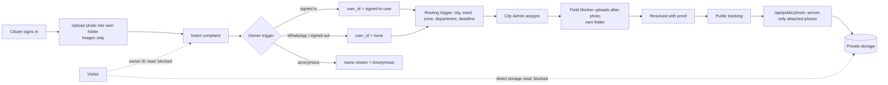

# Civic Tracker — Final Security Remediation Report

Team SANT · Pilot: Ratlam, MP · Date: 2026-11-05 · **Status: NOT PUBLISHED**

## 1. Executive summary
The three open issues (photo storage, complaint ownership, anonymous privacy) are fixed in the preview with backward-compatible database and storage rules. A new 30-check suite passes 30/30. All earlier suites still pass. Existing complaints, photos, profiles, audit history and the Super Admin account are unchanged. The live site still runs the old code until you publish.

## 2. Findings, root causes and fixes
| # | Finding | Root cause | Fix |
|---|---|---|---|
| 1 | Anyone could read files straight from photo storage; any signed-in user could upload anywhere, any file type | Storage read policy had no role check; upload policy only checked "signed in" | Direct reads limited to the file owner and staff. Uploads limited to your own folder (`<your id>/…`) and image types (jpg, jpeg, png, webp, gif, heic, heif). Overwrites limited to the owner. The photo link only serves files that are attached to a complaint. |
| 2 | A citizen could file a complaint under another person's account | Insert rule only checked "signed in" | A server-side rule now sets the owner to the signed-in user. Spoof attempts are corrected and written to the audit log. Signed-out (WhatsApp) inserts can't claim an account. Owner changes are blocked (only the Super Admin can change them). |
| 3 | Public visitors could see the account behind anonymous complaints | `user_id` and `submitted_by` could be read through the public API | The filer account ID can no longer be read by visitors or citizens. Anonymous complaints always show "Anonymous". "My complaints" now asks the server which complaints are yours. |

### Why a stable proxy link instead of signed URLs
Existing records store permanent links like `/api/public/photo/<path>`. Switching to signed URLs would break CT-14's photos and every printed poster or QR code. The proxy is equivalent: storage stays private, nothing can be listed, unattached uploads return 404, and caching dropped from 1 year to 1 hour. Signed-out users can't create signed URLs (check S10).

## 3. Database and storage changes (migration `0017_secure_photos_ownership_anonymity`)
- New `enforce_complaint_owner()` with a `BEFORE INSERT OR UPDATE` trigger on complaints.
- `REVOKE SELECT (user_id) ON complaints FROM anon, authenticated`.
- New `my_complaint_ids()` (signed-in users only, returns only your own IDs).
- Storage: replaced `complaint-photos public read` with `owner or staff read`; replaced the upload policy with `upload own folder` (images only); tightened `owner update` (removed the admin exception).
- Earlier this session: `0016_fix_home_city_regex`.

## 4. API, backend and frontend changes
- `src/routes/api/public/photo.$.ts`: serves only attached photos. Adds nosniff, CORS for posters and a 1-hour cache.
- `src/routes/api/public/fn/civic-chat.ts`: counts use `id` instead of `*`.
- `src/lib/db-columns.ts`: `user_id` removed from the public complaint column list.
- `src/components/pages/Profile.tsx`: "My complaints" uses `my_complaint_ids()`.
- `src/components/pages/Admin.tsx`: staff after-photos are saved in the staff member's own folder.
- `scripts/e2e-photo-ownership.ts`: new 30-check suite.
- Earlier: `src/lib/api-guard.ts` moved out of the server-only folder (fixed the broken build).

## 5. Test results (run one after another, with the Super Admin safety lock)
| Suite | Result |
|---|---|
| Photo / ownership / anonymity (new) | **30/30 PASS** |
| Security | 45/45 PASS |
| Complaint lifecycle (includes worker after-photo proof) | 23/23 PASS |
| City onboarding | 21/21 PASS |
| GPS routing | 34 PASS / 4 SKIP |
| AI / innovation | 25/25 PASS |
| Earlier scan fixes | 31/31 PASS |

## 6. Browser evidence (`CivicTrackerSubmission/security_evidence_v2/`)
- `01_Public_Complaint_List.png`: list loads signed out, all 4 photo thumbnails render, no account IDs.
- `02_Public_Tracking_Before_After.png`: CT-14 before and after photos render.
- `03_Public_Map.png`, `04_Public_Heatmap.png`, `05_Department_Accountability.png`: load with no errors.
- `06_Direct_Storage_Blocked.png`: a signed-out direct storage request was refused (status 400).
- `07_Public_Owner_ID_Blocked.png`: a public request for complaint owner IDs was refused (401, permission denied).
- `08_Complaint_Poster_With_Photo.png`: poster photo is **broken in the preview only**. The stored link points to the live domain and the live server doesn't send the header that posters need. The new code adds it (verified on the preview server). **PARTIAL until published.**
- `09_Owner_My_Complaints.png`, `10_Owner_Tracking_View.png`: the DEMO citizen still sees both of their complaints (CT-14 and CT-142).

## 7. Data and Super Admin integrity (after all runs)
Root ID `4169471f-…3a23` is unchanged. Roles admin:ALL and moderator:ALL are active. The only city-less staff rows are the root's own two. There are 3 complaints: CT-14 and CT-142 are still owned by the DEMO citizen, and CT-29 has no owner, as before. There are 2 photos and 5 profiles. The audit log grew to 1019 rows and was not edited. Test cleanup removed only objects and records that the tests created.

## 8. Rollback (deletes no data or files)
```sql
DROP TRIGGER a_enforce_complaint_owner ON public.complaints;
GRANT SELECT (user_id) ON public.complaints TO anon, authenticated;
DROP POLICY "complaint-photos owner or staff read" ON storage.objects;
CREATE POLICY "complaint-photos public read" ON storage.objects FOR SELECT USING (bucket_id='complaint-photos');
DROP POLICY "complaint-photos upload own folder" ON storage.objects;
CREATE POLICY "Authenticated users can upload complaint photos" ON storage.objects FOR INSERT WITH CHECK (bucket_id='complaint-photos' AND auth.uid() IS NOT NULL);
```
Then restore `user_id` in `COMPLAINT_COLS` and the previous photo route. Photo access never depended on these policies (the route uses the server key), so existing links keep working either way.

## 9. Remaining limitations
- Real camera upload in the browser was not tested. Uploads were tested through the same storage API with temporary accounts.
- Staff can't see the account behind an anonymous complaint in the dashboard (no screen needed it). It remains in the database for the Super Admin.
- File-type checks use the file extension. A size limit for the photo folder was not set.
- Poster and PDF photo display on the live site needs a publish to confirm.
- SECURITY DEFINER linter warnings were reviewed earlier, not changed.
- The live site runs the old code until you publish.

## 10. Verdict
The three findings are fixed and tested in the preview. **Ready to publish for the MVP/hackathon**, after which poster photos and the live checks should be re-verified. Not claimed to be 100% secure.


